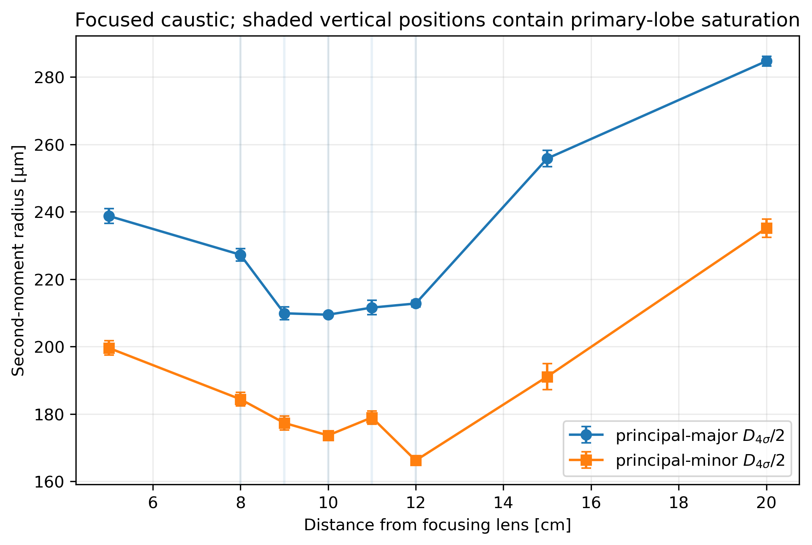
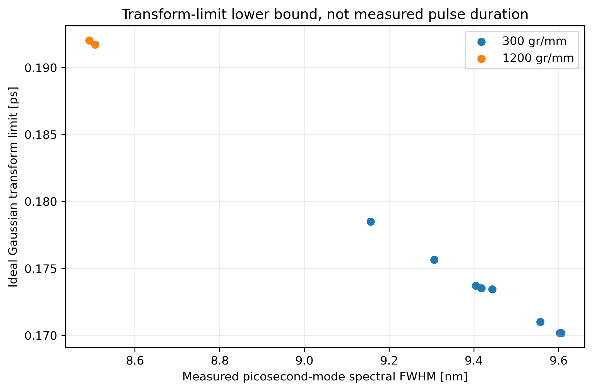
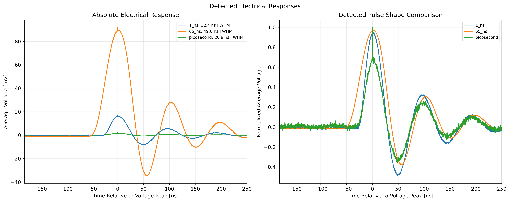

# Pump-Probe Laser Characterization


<p align="center">
  
</p>

Spatial, temporal, spectral, and power characterization of the two lasers in the
pump-probe spectroscopy platform I built in **Kim's Club 2.0** at California State
University, San Bernardino (PI: Dr. Martin Youngmin Kim):

| Role | Laser | Detector |
|---|---|---|
| Pump | Coherent COMPASS 315M-100, 532 nm CW | Basler acA3088-57uc CMOS (Beam Profile), HORIBA iHR550 + Synapse Plus CCD |
| Probe | Thorlabs GSL106A, 1064 nm, CW / ps / 1 ns / 65 ns Modes at 200 kHz | Thorlabs PDA36A + Keysight DSO6104A, iHR550, Thorlabs PM100D/S121C |

**Author:** Alex G. Gauthier &nbsp;·&nbsp; [LinkedIn](https://www.linkedin.com/in/Alex-G-Gauthier/)

*I set up and took all of the measurements (119 raw files). The analysis code and report were written with AI assistance;
I directed the analysis and checked the results against the instruments' documentation.*

## Key Findings

| Quantity | Result |
|---|---|
| Repetition Rate | **200.0003 kHz** (200000.30-200000.38 Hz across three long records) |
| Picosecond Mode Bandwidth | **8.49-9.61 nm** FWHM |
| Picosecond Pulse Duration | **0.17-0.19 ps** transform limit for a Gaussian pulse (a lower bound, not a measurement) |
| Pulse Energy, 65 ns Mode | **1.65-1.70 nJ** per pulse (330-340 µW average power at 200 kHz) |
| Pulse Energy, ps and 1 ns Modes | Greater than 6.75 pJ and 47 pJ (the measured powers were lower bounds) |
| Average Power | 532 nm: >130 mW; 1064 nm CW: >16 mW |
| 532 nm Beam | Focus 10-12 cm after a 100 mm lens; elliptical near the focus (axis ratio 1.18-1.34), nearly round without the lens (1.02-1.05) |
| 532 nm M² | Provisional 2.5 / 1.8 along the principal axes (measured to about 1 Rayleigh length instead of 2) |
| Electrical Pulse Widths | 20.9 ns (ps mode), 32.4 ns (1 ns mode), 49.0 ns (65 ns mode): set by the 10 MHz photodiode, not the laser |

The analysis is deliberately strict about **what the data can and cannot support**:
detector limited pulse widths are not reported as optical pulse durations and
instrument limited linewidths are not reported as intrinsic linewidths. The main lesson was about the
measurement chain itself: several numbers that look like laser specifications turned out to be properties
of the photodiode or the spectrometer.

<table>
<tr>
<td width="50%"></td>
<td width="50%"></td>
</tr>
<tr>
<td><b>532 nm beam through the focus.</b> Second-moment radius along the beam's two principal axes; shaded positions have saturated pixels.</td>
<td><b>Picosecond mode.</b> Measured spectral width and the shortest pulse it allows (a lower bound, not a measurement).</td>
</tr>
</table>

<p align="center"></p>
<p align="center"><i>Averaged photodiode signal for the three pulsed modes. The ringing after each peak comes from the detector chain, not the laser.</i></p>

## Experimental Setups

| Measurement Domain | Source & Measurement Chain |
|---|---|
| 532 nm Spatial | Coherent COMPASS 315M-100 CW laser; Thorlabs reflective ND filter(s); one mirror; direct interception by a Basler acA3088-57uc color CMOS sensor; no imaging lens or relay; optional 100 mm plano convex focusing lens |
| 1064 nm Temporal | Thorlabs GSL106A fiber output; Agilent 33120A external trigger at nominal 200 kHz; legacy Thorlabs PDA36A at 0 dB; Agilent/Keysight DSO6104A; CH1 internally terminated at 50 ohm for quantitative records; CH3 monitors the function-generator output |
| 532/1064 nm Spectral | HORIBA iHR550 imaging spectrometer with Synapse Plus CCD; free-space front-port input; 300, 1200, and 1800 groove/mm gratings; LabSpec signal-dark correction; binning 1; one accumulation |
| 532/1064 nm Power | Thorlabs S121C & PM100D |

The reported 532 nm source output is 130 mW. This value is retained as experimental metadata, not treated as a verified manufacturer specification. The source warm up was greater than two minutes, which is a limitation for drift sensitive comparisons.

## Central Conclusions

| Claim | Status |
|---|---|
| 532 nm beam size versus axial position | Supported with caveats: direct pixel scale and three independent frames per position, but no native dark frame and saturation near the focused minimum |
| 532 nm M-squared | Not supported by the present scan: only eight focused positions, five saturated waist-region positions, fewer than two fitted Rayleigh ranges on either side, and no recorded distance uncertainty |
| GSL106A Repetition Rate | Supported as a measurement chain result: 200000.295 to 200000.384 Hz in the three long 50 ohm impedance records |
| Electrical Pulse Response | Supported for the properly terminated records |
| Optical Picosecond, 1 ns, and 65 ns Pulse Durations | Not established by this detector chain; the first two are unresolved and the 65 ns waveform remains detector limited |
| 532 nm & 1064 nm Intrinsic Linewidths | Not supported: narrow lines are under sampled and the spectrometer line spread function was not measured; the 1064 nm width grows 4x from a 10 µm to a 200 µm slit |
| Picosecond Mode Spectral Bandwidth | Supported with caveat: 8.492 to 9.606 nm FWHM, well sampled, but not corrected for total spectral response |
| Picosecond Pulse Duration | Supported only as an ideal lower bound: 0.170 to 0.192 ps for a Gaussian intensity profile |
| Pulse Energy | Supported: 1.65-1.70 nJ in the 65 ns mode; lower bounds for the ps and 1 ns modes |
| Absolute 1064 nm Wavelength | Plausible but not validated: visible mercury calibration was not checked with a near 1064 nm reference |

See [`docs/results_summary.md`](docs/results_summary.md) for the full interpretation and numerical tables, and the full
[31-page report](report/Complete_Laser_Characterization_Report.pdf).

## What Would Improve the Measurements

- **For a final M²:** repeat the focus scan with more attenuation (no saturation), at least 10 positions out to 2 Rayleigh lengths on each side, and record the stage position uncertainty.
- **For optical pulse widths:** a faster detector for the 1 ns and 65 ns modes, and an autocorrelator for the picosecond mode.
- **For absolute 1064 nm wavelengths:** calibrate the spectrometer with a reference line near 1064 nm (the calibration used mercury lines at 436 and 546 nm only).

The full list is in [`docs/calibration_checklist.md`](docs/calibration_checklist.md).

## Project Contents

```
notebooks/
  00_Start_Here.ipynb                     setup, data inventory, reporting rules
  01_Spatial_532nm.ipynb                  beam size, ellipticity, focus scan, provisional M²
  02_Temporal_1064nm.ipynb                pulse trains, averaging, repetition rate, pulse energy
  03_Spectral_532_1064nm.ipynb            spectra, slit broadening, bandwidth, transform limits
  04_Integrated_Summary.ipynb             all results with a confidence rating for each
  05_Complete_Report_and_Data_Audit.ipynb power, completeness and file-by-file traceability
report/Complete_Laser_Characterization_Report.pdf   the 31-page report
docs/
  results_summary.md         detailed results and interpretation
  methods.md                 analysis principles, uncertainty, limitations, how to reproduce
  analysis_decisions.md      definitions and why each claim is or is not made
  calibration_checklist.md   what to measure next
  sources.md                 instrument documentation used
  source_data_manifest.sha256    checksums of the 119 raw files
laser_characterization.py, laser_characterization_core.py   analysis code
run_all_analyses.py          recomputes outputs/ from the raw data
validate_project.py          checks outputs, key numbers, figures and notebooks
outputs/                     every result as CSV/JSON
figures/                     every figure in the notebooks and report
experiment_metadata.json     setup facts and known unknowns
```

## Run It

```bash
python -m pip install -r requirements.txt
python validate_project.py         # checks saved outputs, numbers, figures and notebooks
jupyter lab notebooks/00_Start_Here.ipynb
```

The raw 1.1 GB measurement archive is not included. The notebooks run from the saved results in
`outputs/`; cells that need raw data show the saved figure instead. To recompute everything from the raw
files, see [`docs/methods.md`](docs/methods.md).

MIT License.
