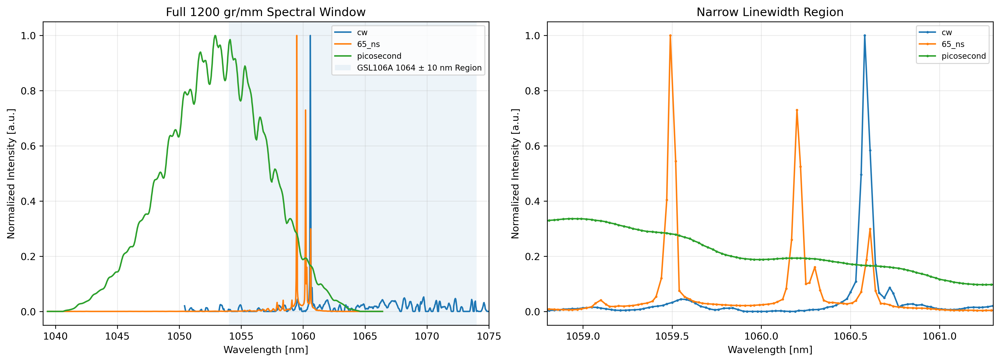

# Pump–Probe Laser Characterization (532 nm & 1064 nm)


<p align="center">
  
</p>

Spatial, temporal, spectral and power characterization of the two lasers in the
pump–probe spectroscopy platform I built in **Kim's Club 2.0** at California State
University, San Bernardino (PI: Dr. Martin Youngmin Kim):

| Role | Laser | Measured with |
|---|---|---|
| Pump | Coherent COMPASS 315M-100, 532 nm CW | Basler acA3088-57uc CMOS (beam profile), HORIBA iHR550 + Synapse Plus CCD |
| Probe | Thorlabs GSL106A, 1064 nm, CW / ps / 1 ns / 65 ns modes at 200 kHz | Thorlabs PDA36A + Keysight DSO6104A, iHR550, Thorlabs PM100D/S121C |

**Author:** Alex G. Gauthier &nbsp;·&nbsp; [LinkedIn](https://www.linkedin.com/in/Alex-G-Gauthier/)

*I set up and took all of the measurements. The analysis code and report were written with AI assistance;
I directed the analysis and checked the results against the instruments' documentation.*

### Key results
- **Repetition rate:** 200.0003 kHz, measured across three long records.
- **Picosecond-mode bandwidth:** 8.49–9.61 nm FWHM, implying a transform-limited
  duration of 0.17–0.19 ps for a Gaussian pulse (a lower bound, not a measurement).
- **Pulse energy:** 1.65–1.70 nJ per pulse in 65 ns mode, from average power at 200 kHz.
- **532 nm beam:** second-moment beam size vs. focus position from native 12-bit RAW frames,
  with a provisional M² of 2.5 / 1.8 along the principal axes.

The analysis is deliberately strict about **what the data can and cannot support**:
detector-limited pulse widths are not reported as optical pulse durations, and
instrument-limited linewidths are not reported as intrinsic linewidths. See
[`RESULTS_SUMMARY.md`](RESULTS_SUMMARY.md) and the full
[31-page report](report/Complete_Laser_Characterization_Report.pdf).

### Run it
```bash
python -m pip install -r requirements.txt
python verify_installation.py      # checks modules and precomputed outputs
jupyter lab 00_Start_Here.ipynb    # then notebooks 01-05
```
The raw 1.1 GB measurement archive is not included. The notebooks run from the
precomputed results in `outputs/`; raw-data-only plots are skipped.

---

## Detailed methods

This is a reproducible Jupyter project for the supplied spatial, temporal, and spectral measurements. The analysis is deliberately claim-aware: it reports measured numerical quantities while separately stating whether each quantity can be interpreted as an intrinsic laser property.

## Experimental system represented in this project

| Measurement domain | Source and measurement chain |
|---|---|
| 532 nm spatial | Coherent COMPASS 315M-100 CW laser; Thorlabs reflective ND filter(s); one mirror; direct interception by a Basler acA3088-57uc color CMOS sensor; no imaging lens or relay; optional 100 mm plano-convex focusing lens |
| 1064 nm temporal | Thorlabs GSL106A fiber output; Agilent 33120A external trigger at nominal 200 kHz; legacy Thorlabs PDA36A at 0 dB; Agilent/Keysight DSO6104A; CH1 internally terminated at 50 ohm for quantitative records; CH3 monitors the function-generator output |
| 532/1064 nm spectral | HORIBA iHR550 imaging spectrometer with Synapse Plus CCD; free-space front-port input; 300, 1200, and 1800 groove/mm gratings; LabSpec signal-dark correction; binning 1; one accumulation |

The user-reported 532 nm source output is 130 mW. This value is retained as experimental metadata, not treated as a verified manufacturer specification. The source warm-up was approximately two minutes, which is a limitation for drift-sensitive comparisons.

## Central scientific verdict

| Claim | Status |
|---|---|
| Selected-lobe 532 nm beam size versus axial position | Supported with caveats: direct pixel scale and three independent frames per position, but no native dark frame and saturation near the focused minimum |
| Final standards-grade 532 nm M-squared | Not supported by the present scan: only eight focused positions, five saturated waist-region positions, fewer than two fitted Rayleigh ranges on either side, and no recorded z uncertainty |
| GSL106A repetition rate | Supported as a measurement-chain result: 200000.295 to 200000.384 Hz in the three long 50 ohm records |
| Electrical pulse response | Supported for the properly terminated records |
| Optical picosecond, 1 ns, or 65 ns pulse duration | Not established by this detector chain; the first two are unresolved and the 65 ns waveform remains detector-convolved |
| 532 nm and narrow 1064 nm intrinsic linewidth | Not supported: narrow lines are undersampled and the spectrometer line-spread function was not measured |
| Picosecond-mode spectral bandwidth | Supported with caveat: 8.492 to 9.606 nm FWHM, well sampled, but not corrected for total spectral response |
| Transform-limited picosecond duration | Supported only as an ideal lower bound: 0.170 to 0.192 ps for a Gaussian intensity profile |
| Absolute 1064 nm wavelength | Plausible but not validated: visible mercury calibration was not checked with a near-1064 nm reference |

See `RESULTS_SUMMARY.md` for the full interpretation and numerical tables.

## Project contents

- `00_Start_Here.ipynb`: configuration, source identity, dataset inventory, reporting rules, and high-level verdict.
- `01_Spatial_532nm.ipynb`: native 12-bit Bayer analysis, primary-lobe selection, second moments, Gaussian diagnostics, saturation/clipping checks, repeatability, provisional caustic fits, local no-lens expansion, centroid trajectory, and separate legacy-PNG review.
- `02_Temporal_1064nm.ipynb`: scope metadata audit, long-record visualization, coherent averaging, pulse-shape and stability metrics, hysteretic trigger timing, 50 ohm versus 1 Mohm comparison, and pulse-energy calculation from entered average powers.
- `03_Spectral_532_1064nm.ipynb`: baseline-corrected spectra, center and width metrics, sampling adequacy, slit broadening, acquisition-state separation, repeatability, and transform-limit lower bounds.
- `04_Integrated_Summary.ipynb`: compact numerical summary and claim-confidence matrix.
- `*.executed.ipynb`: fully executed copies generated from the supplied archive. Every code cell has an execution count and no error output.
- `laser_characterization.py`: experiment-aware public analysis API and quality-control logic.
- `laser_characterization_core.py`: preserved numerical parsing/fitting core.
- `run_all_analyses.py`: command-line regeneration of all processed CSV/JSON results.
- `verify_installation.py`: parser, output, numerical-regression, and notebook-execution checks.
- `experiment_metadata.json`: resolved setup facts and remaining unknowns.
- `outputs/`: machine-readable analysis tables.
- `figures/`: notebook-generated publication-resolution figures.
- `RESULTS_SUMMARY.md`: detailed scientific interpretation.
- `ANALYSIS_DECISIONS.md`: definitions, assumptions, and reasons for blocked claims.
- `CALIBRATION_CHECKLIST.md`: only the remaining information and measurements that would change a final claim.
- `SOURCES.md`: instrument-document provenance and the boundary between manufacturer facts and user-reported metadata.
- `SOURCE_DATA_MANIFEST.sha256`: hashes of the original extracted measurement files.
- `PROJECT_MANIFEST.sha256`: hashes of the packaged project files.

## Analysis principles

### Spatial analysis

The Basler RAW files are treated as 3088 x 2064 arrays of right-aligned 12-bit values stored in 16-bit words. The two green photosites in each 2 x 2 Bayer cell are averaged to produce a 1544 x 1032 interpolation-free green image. With direct interception and no relay optics, one green superpixel corresponds to 4.8 um in each transverse direction.

A robust planar background is estimated from image-perimeter pixels because matched native dark frames were not recorded. The highest-intensity connected lobe is treated as the intended beam, following the experimenter's rule. A rotated Gaussian fit localizes that lobe and defines a stable aperture, but the reported beam diameters are second-moment quantities rather than Gaussian-fit widths. Reflections and satellite spots remain visible through full-field metrics and quality flags.

The focused scan is fit to the paraxial second-moment propagation model only as a sensitivity analysis. The project never promotes a numerically converged fit to a final M-squared result unless coverage, saturation, clipping, repeatability, and position metadata all support the claim.

### Temporal analysis

The DSO6104A metadata embedded in each CSV are parsed and checked. The quantitative files confirm CH1 at 50 ohm, CH3 at 1 Mohm, bandwidth limit off, normal real-time acquisition, CH3 trigger, DC trigger coupling, and zero stored channel skew.

The legacy PDA36A at 0 dB is represented by the documented nominal 10 MHz bandwidth, 0.750 kV/A transimpedance into 50 ohm, and 1.51 kV/A into high impedance. The manufacturer also warns that the photodiode rise time can further limit effective bandwidth in the near infrared. A 10 MHz bandwidth provides a step-rise-time scale of about 35 ns; it does not uniquely specify an impulse-response FWHM. No arbitrary Gaussian deconvolution is performed.

Long records are coherently folded at the intended 200 kHz period. CH3 rising edges are detected with a hysteretic threshold and a refractory interval to prevent ringing from being counted as extra pulses. Timing residuals are explicitly labeled as function-generator plus oscilloscope plus laser plus detector-chain metrics, not intrinsic laser jitter.

### Spectral analysis

HORIBA text files are parsed directly, including decimal commas and acquisition metadata. A robust edge-based linear baseline is used. Peak wavelength, centroid, nonparametric FWHM, RMS width, equivalent width, frequency bandwidth, resolving power, and points per FWHM are reported.

A narrow measured FWHM is not called an intrinsic linewidth without an instrument line-spread function measured at the same wavelength, grating, slit, detector, and acquisition settings. Fewer than three sampled points across FWHM is treated as undersampled for quantitative line-shape interpretation. The project's 85 percent full-scale threshold is a conservative data-quality warning, not a Synapse Plus linearity specification.

## Uncertainty and significant figures

No confidence level or uncertainty budget is invented. The project uses:

- observed standard deviations across independent repeated frames or time-contiguous repeated spectra;
- conditional curve-fit covariance only as a fit diagnostic;
- explicit systematic limitations for missing dark frames, z uncertainty, wavelength-calibration residuals, spectral response, detector impulse response, and power-chain calibration.

CSV files retain extra digits to make numerical regeneration testable. Narrative results normally use at least three significant figures, but displayed digits are not presented as uncertainty.

## Installation

Python 3.10 or newer is recommended.

```bash
python -m venv .venv
source .venv/bin/activate
python -m pip install --upgrade pip
python -m pip install -r requirements.txt
python -m ipykernel install --user --name laser-characterization
```

On Windows, activate with `.venv\Scripts\activate`.

## Data placement

The project archive does not duplicate the roughly 1.1 GB measurement archive. Extract the original data so that one of these layouts exists:

```text
laser-characterization/
    data/
        532 and 1064/
            532nm_Spatial/
            Pulse_Data/
            Spectral_Data/
```

or

```text
parent_directory/
    laser-characterization/
    532 and 1064/
```

`find_data_root()` searches both layouts. For a custom location, pass it explicitly:

```bash
python run_all_analyses.py --data-root "/absolute/path/to/532 and 1064"
```

## Reproduce the outputs

From the project directory:

```bash
python run_all_analyses.py --force
jupyter nbconvert --to notebook --execute 00_Start_Here.ipynb --output 00_Start_Here.executed.ipynb
jupyter nbconvert --to notebook --execute 01_Spatial_532nm.ipynb --output 01_Spatial_532nm.executed.ipynb
jupyter nbconvert --to notebook --execute 02_Temporal_1064nm.ipynb --output 02_Temporal_1064nm.executed.ipynb
jupyter nbconvert --to notebook --execute 03_Spectral_532_1064nm.ipynb --output 03_Spectral_532_1064nm.executed.ipynb
jupyter nbconvert --to notebook --execute 04_Integrated_Summary.ipynb --output 04_Integrated_Summary.executed.ipynb
python validate_project.py --data-root "/absolute/path/to/532 and 1064"
```

The `--force` option reparses every raw file. Without it, the runner reuses existing per-file metric tables and regenerates derived summaries.

## Enter average power and calculate pulse energy

Edit `outputs/average_power_inputs.csv` and enter the independently measured average power for each pulsed mode. The temporal notebook calculates

```text
pulse energy = average power / measured repetition rate
```

Peak power is intentionally not calculated because the optical pulse duration and shape are not established by the current detector chain.

## Current limitations that materially affect interpretation

- Approximately two minutes of laser warm-up may be insufficient for thermal stability.
- No matched native Bayer dark frames were recorded; camera black level and gamma were not recorded.
- Five of eight focused positions contain saturated pixels inside the selected primary aperture.
- Spatial z-position uncertainty and focusing-lens part number/orientation were not recorded.
- PDA36A responsivity at 1064 nm and ND-filter transmission at 1064 nm were not supplied.
- Average-power values were not supplied numerically.
- Spectrometer calibration residuals, grating blaze/order-sorting details, actual minimum slit gap, detector variant, and near-1064 nm reference were not recorded.
- The spectrometer system response was not corrected.

These omissions do not make all data unusable. They define which statements are relative measurement-chain observations and which intrinsic laser claims remain unsupported.
